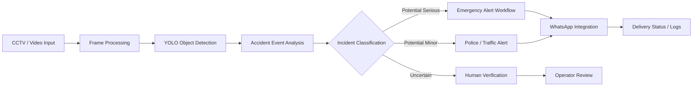

# NexGuard — AI-Powered Accident Detection & Emergency Alert System

<p align="center">
  <strong>Detect faster. Alert smarter. Respond sooner.</strong>
  <br />
  An AI-powered CCTV surveillance system designed to detect potential road accidents and support emergency response workflows.
</p>

<p align="center">
  
  
  
  
</p>

<p align="center">
  
  
  
  
</p>

---

## Table of Contents

- [Overview](#overview)
- [Problem Statement](#problem-statement)
- [Objectives](#objectives)
- [Key Features](#key-features)
- [System Architecture](#system-architecture)
- [Technology Stack](#technology-stack)
- [Project Structure](#project-structure)
- [Getting Started](#getting-started)
- [Configuration](#configuration)
- [How It Works](#how-it-works)
- [Testing](#testing)
- [Deployment](#deployment)
- [Safety and Limitations](#safety-and-limitations)
- [Future Scope](#future-scope)
- [Contributing](#contributing)
- [Team](#team)
- [License](#license)

---

## Overview

**NexGuard** is an AI-powered road surveillance and accident detection project that uses computer vision to analyze CCTV footage or video input for potential road accidents.

The system is designed to process video frames using a YOLO-based object detection model, analyze possible accident events, classify incident severity where supported by the detection logic, and initiate appropriate notification workflows.

The goal is to reduce reliance on continuous manual monitoring and help relevant responders receive incident information more quickly.

NexGuard is intended as an assistance system for road safety and emergency response. Actual detection performance and notification capabilities depend on the trained model, configured rules, video input, and connected messaging services.

## Problem Statement

Road accidents can require rapid intervention, but manual monitoring and incident reporting may introduce delays.

Key challenges include:

- **Delayed Detection:** Accidents may not be noticed immediately when surveillance feeds are monitored manually.
- **Continuous Monitoring:** Monitoring multiple camera feeds can be difficult for human operators.
- **Incident Classification:** Different incidents may require different response procedures.
- **Notification Delays:** Relevant responders need timely and useful incident information.
- **Limited Automation:** Existing surveillance setups may lack an integrated computer vision and alert workflow.

NexGuard explores how AI-powered video analysis can support earlier incident detection and structured emergency notifications.

## Objectives

- Analyze video footage using a YOLO-based detection model.
- Identify potential accident events using configured detection logic.
- Classify incidents by severity when supported by the implementation.
- Trigger configurable notification workflows.
- Provide a terminal-based execution and monitoring interface.
- Establish a foundation for future CCTV and edge-computing integration.

---

## Key Features

### 1. AI-Powered Object Detection

- YOLO-based computer vision.
- Frame-by-frame video analysis.
- Detection of objects learned by the configured model.
- Support for compatible video input sources.
- Terminal output for monitoring model execution.

**Note:** Detecting objects is not equivalent to reliably detecting accidents. Accident recognition requires appropriate training data, temporal analysis, or validated incident-detection logic.

### 2. Accident Event Analysis

The accident-analysis stage evaluates detection results to identify potential incident events.

Depending on the implementation, this stage may incorporate:

- Detected object classes.
- Object positions and movement.
- Interactions between vehicles.
- Temporal changes across video frames.
- Configured accident-detection rules.

Detection accuracy depends on the model, dataset, lighting, camera angle, occlusion, and quality of the footage.

### 3. Incident Severity Classification

NexGuard is designed to support incident classification for different response workflows.

An illustrative response policy could be:

| Incident category | Intended workflow |
|---|---|
| Potential serious accident | Escalation for emergency medical review |
| Potential minor accident | Police or traffic-authority review |
| Uncertain detection | Human verification |
| False positive | Suppress escalation after verification |

The categories and escalation rules must be implemented and validated against the actual detection pipeline. A computer vision prediction alone cannot reliably establish injury severity.

### 4. WhatsApp Notification Workflow

NexGuard is designed to support incident notifications through a configured WhatsApp integration.

A notification workflow may include:

- Incident classification.
- Detection timestamp.
- Camera or location identifier, when available.
- Confidence or verification status.
- Relevant incident details.
- Configured recipient and escalation rules.

Actual delivery requires a working messaging integration, valid credentials, authorized recipients, and appropriate provider configuration. A terminal message alone does not confirm that an alert was delivered.

### 5. Terminal-Based Execution

The project is designed to run through Python rather than requiring a browser-based interface.

Example command:

```bash
python main.py
```

The terminal can be used to observe startup messages, model initialization, detection events, and integration status, depending on the current implementation.

### 6. Custom Model Training

A custom accident-detection model can be trained using an appropriately labeled dataset supported by the chosen YOLO training framework.

Training requires:

- A dataset containing relevant accident and non-accident examples.
- Consistent annotation and class definitions.
- Training, validation, and test splits.
- A compatible dataset configuration file.
- Evaluation on footage that was not used for training.

The dataset must match the structure expected by the training code.

---

## System Architecture

The following Mermaid diagram shows the high-level accident detection and notification workflow.



### Architecture Components

| Component | Responsibility |
|---|---|
| Video input | Receives CCTV footage or compatible video input |
| Frame processing | Prepares frames for inference |
| YOLO detector | Produces object detections |
| Accident analysis | Evaluates detections for possible accident events |
| Classification | Applies configured incident categories and rules |
| Notification workflow | Selects the appropriate configured alert path |
| WhatsApp integration | Sends messages through the connected service |
| Logging and review | Records events and supports operator verification |

This is a logical architecture. Actual data flow, severity classification, logging, and alert delivery depend on the modules implemented in the repository.

---

## Technology Stack

| Technology | Purpose |
|---|---|
| Python | Main application language |
| YOLO | Object detection |
| OpenCV | Video and frame processing |
| PyTorch | Model inference and training, when used by the selected YOLO framework |
| NumPy | Numerical and array operations, when required |
| WhatsApp integration | Incident notifications through a configured provider |
| Pytest | Automated testing, if configured |

---

## Project Structure

The following is a suggested structure. Keep it aligned with the files actually present in the repository.

```text
NexGuard/
├── main.py
├── requirements.txt
├── README.md
├── models/
├── datasets/
│   ├── images/
│   └── labels/
├── tests/
└── .gitignore
```

### Important Files

| File or directory | Purpose |
|---|---|
| `main.py` | Application entry point |
| `requirements.txt` | Python dependencies |
| `models/` | Model weights or model-related files, if used |
| `datasets/` | Training and evaluation data, if included locally |
| `tests/` | Automated tests, if implemented |
| `README.md` | Project documentation |

Do not commit large datasets, private CCTV footage, API credentials, or model files unless their distribution is appropriate.

---

## Getting Started

### Prerequisites

Install:

- Python 3.10 or later, subject to dependency compatibility.
- pip.
- Git.
- A compatible YOLO model and its required dependencies.
- A compatible video input source.

For custom training, additional GPU resources may improve performance, but the actual requirements depend on model size and dataset scale.

### 1. Clone the Repository

```bash
git clone https://github.com/reddy895/NexGuard.git
cd NexGuard
```

### 2. Create a Virtual Environment

Linux:

```bash
python3 -m venv .venv
source .venv/bin/activate
```

Windows PowerShell:

```powershell
python -m venv .venv
.venv\Scripts\Activate.ps1
```

### 3. Install Dependencies

```bash
python -m pip install --upgrade pip
pip install -r requirements.txt
```

If dependency installation fails, verify that your Python version is supported by the installed model framework and all pinned packages.

### 4. Configure the Model and Input

Before starting the application, confirm that:

- The configured model weights exist.
- The video input source is accessible.
- Required dependencies are installed.
- Any required environment variables are configured.
- The accident-detection dataset is available if custom training is required.

Use the model path and input settings expected by the current code.

### 5. Run NexGuard

```bash
python main.py
```

Observe the terminal output for initialization messages, model loading, detection events, and notification integration status.

---

## Configuration

Configuration depends on the implementation in the repository.

Potential settings include:

| Setting | Purpose |
|---|---|
| Model path | Selects YOLO model weights |
| Video source | Selects a video file, camera, or stream |
| Confidence threshold | Controls the minimum detection confidence |
| Incident rules | Defines how detections are evaluated |
| Recipient configuration | Identifies authorized alert recipients |
| Messaging credentials | Enables the configured notification provider |
| Logging settings | Controls incident records and diagnostic output |

Use environment variables or a protected configuration file for secrets.

Example `.env` structure, if supported by the application:

```env
MODEL_PATH=models/best.pt
VIDEO_SOURCE=0
WHATSAPP_ENABLED=false
```

These are illustrative variable names. Add them to your environment only if the application reads them, and use the exact names expected by the code.

**Never commit real API tokens, messaging credentials, private phone numbers, or secret keys.**

---

## How It Works

1. **Video Acquisition:** The application receives video from a supported input source.
2. **Frame Processing:** Frames are prepared for model inference.
3. **Object Detection:** YOLO predicts objects and their associated detections.
4. **Accident Analysis:** The application evaluates detection results using its configured incident logic.
5. **Classification:** Potential events are assigned categories when supported by the implementation.
6. **Notification Selection:** The configured rules select the appropriate alert workflow.
7. **Alert Delivery:** The messaging integration attempts to deliver an incident notification.
8. **Monitoring:** Logs and delivery status help operators review the event.

Each stage should be tested independently before connecting the system to a live surveillance or emergency workflow.

---

## Testing

If the repository includes a Pytest suite, run:

```bash
python -m pytest -v
```

Recommended validation areas include:

- Model loading and inference.
- Video input handling.
- Detection confidence thresholds.
- Accident-event classification.
- False-positive and false-negative behavior.
- Incident severity rules.
- Messaging integration failures.
- Missing or invalid configuration.
- Logging and error recovery.

Evaluate the system on representative footage that was not used during training. Report precision, recall, false-positive rates, and detection latency when these metrics have actually been measured.

---

## Deployment

NexGuard is primarily a Python computer vision application.

Potential deployment environments include:

- Local development machines.
- Compatible GPU-enabled workstations.
- Edge-computing devices connected to supported cameras.
- Dedicated servers processing authorized CCTV streams.

### Deployment Checklist

- Verify model compatibility and inference performance.
- Configure the video source securely.
- Protect messaging credentials.
- Test notification delivery with non-emergency recipients.
- Add logging and error handling.
- Verify incident classification against representative footage.
- Provide human review for uncertain or high-impact events.
- Obtain authorization before processing CCTV footage.

A production deployment requires more than a successful local model run. It needs reliable input handling, validated detection logic, secure configuration, operational monitoring, and tested notification delivery.

---

## Safety and Limitations

NexGuard is an experimental decision-support system and must not be treated as a fully autonomous emergency-dispatch system without extensive validation and appropriate authorization.

- Object detection does not independently prove that an accident occurred.
- Video alone may not establish injury severity.
- Poor lighting, occlusion, camera placement, and low-quality footage can affect accuracy.
- False positives can generate unnecessary alerts.
- False negatives can cause incidents to be missed.
- Messaging providers may experience delivery failures or delays.
- Emergency notifications must use verified recipients and approved procedures.
- Human operators should review uncertain detections and high-impact alerts.
- CCTV footage and incident records must be handled in accordance with applicable privacy and legal requirements.

Do not rely on NexGuard as the sole means of detecting accidents or contacting emergency services.

---

## Future Scope

Potential future improvements include:

- Multi-camera monitoring.
- Tracking objects across consecutive frames.
- Temporal accident recognition.
- Improved severity estimation with validated supporting evidence.
- Edge inference optimization.
- Secure incident dashboards.
- Configurable alert escalation policies.
- Notification delivery acknowledgements.
- Incident history and analytics.
- Model evaluation dashboards.
- Privacy-aware video retention and access controls.
- Robust testing on diverse real-world road conditions.

---

## Contributing

Contributions, bug reports, and suggestions are welcome.

1. Fork the repository.
2. Create a feature branch.
3. Make your changes.
4. Run relevant tests.
5. Commit with a descriptive message.
6. Submit a pull request.

Example:

```bash
git checkout -b feature/your-feature
git add .
git commit -m "feat: describe your change"
git push origin feature/your-feature
```

Please avoid committing credentials, private surveillance footage, or sensitive incident information.

---

## Team

- **PRAVEEN**

---

## License

See the repository's `LICENSE` file for the applicable licensing terms. If no license has been added, specify the intended license before presenting the project as open source.

---

## Author and Repository

**GitHub:** [reddy895/NexGuard](https://github.com/reddy895/NexGuard)

---

<p align="center">
  <strong>NexGuard</strong><br />
  AI-assisted road safety through computer vision and incident awareness.
</p>
